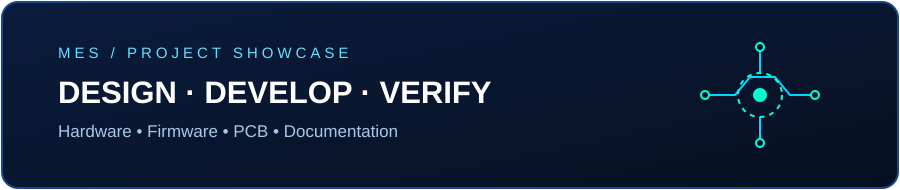

# MES-3DStencilJig

  

<h3 dir="rtl" align="right">ساخت فیکسچر سه‌بعدی برای نگه‌داشتن شابلن استنسیل استیل بدون فریم (Frameless Stainless Steel Stencil) روی برد مدار چاپی (PCB) و اعمال خمیر قلع</h3>

<b>نام فارسی پروژه:</b> ساخت فیکسچر با پرینتر سه‌بعدی برای نگه‌داشتن شابلن استنسیل استیل بدون فریم (Frameless Stainless Steel Stencil) روی برد مدار چاپی (PCB) و کشیدن خمیر قلع روی برد

  

  <b>A fully 3D-printable, adjustable stencil jig for accurate manual solder-paste application on prototype and small-batch PCBs.</b>
   
  <b>فیکسچر قابل چاپ سه‌بعدی و قابل تنظیم برای نگه‌داری و هم‌راستاسازی شابلن استنسیل و اعمال دستی و دقیق خمیر قلع روی بردهای مدار چاپی؛ مناسب نمونه‌سازی و تولید در تیراژ محدود.</b>

  <a href="#معرفی-پروژه">فارسی</a> |
  <a href="#project-overview">English</a>

---

  

## معرفی پروژه

 یک فیکسچر مکانیکی با قطعات قابل چاپ سه‌بعدی است که برای نگه‌داشتن، ثابت‌کردن و هم‌راستا کردن شابلن استنسیل استیل بدون فریم (**Frameless Stainless Steel Stencil**) روی برد مدار چاپی (**PCB**) طراحی شده است.

پس از قرار دادن PCB در محل خود و تنظیم شابلن در موقعیت صحیح، می‌توان خمیر قلع را با کاردک (Squeegee) به‌صورت دستی روی سطح شابلن کشید تا خمیر از منافذ آن عبور کرده و روی پدهای موردنظر برد مدار چاپی قرار بگیرد. این فیکسچر به ثابت ماندن شابلن و PCB در حین کار کمک می‌کند و برای نمونه‌سازی، مونتاژ دستی و تولید بردهای الکترونیکی در تیراژ محدود مناسب است.

در این طراحی، سه ریل راهنمای **bar1**، **bar2** و **bar_top** وظیفه نگه‌داشتن شابلن را بر عهده دارند. هر ریل با چرخش ۱۸۰ درجه برای دو ضخامت متفاوت قابل تنظیم است. همچنین با انتخاب **PCB Pusher** متناسب با گروه ضخامت، می‌توان از فیکسچر برای شابلن‌های استیل با ضخامت‌های مختلف استفاده کرد.

### ویژگی‌ها

- طراحی قابل ساخت با پرینتر سه‌بعدی و قطعات مکانیکی متداول
- مناسب برای اعمال دستی خمیر قلع روی PCB
- قابلیت تنظیم برای شابلون‌های با ضخامت‌های **0.6، 0.8، 1.0، 1.2، 1.6 و 2.0 میلی‌متر**
- دارای پایه با ابعاد اسمی **200 × 200 میلی‌متر**
- استفاده از PCB Pusher متناسب با گروه ضخامت ریل‌ها
- فایل‌های سه‌بعدی قطعات با فرمت STL در پوشه [3d](3d/)
- تصاویر قطعات و نمای فیکسچر در پوشه [docs](docs/)
- ویدئوی مونتاژ و نمونه نتیجه اعمال خمیر قلع در پوشه [Video](Video/)

## تصاویر پروژه

  
  

  
  

  

## فایل‌های پرینت سه‌بعدی

تمام فایل‌های مدل سه‌بعدی قابل دریافت در پوشه **[3d](3d/)** قرار دارند و با فرمت STL ارائه شده‌اند.

### انتخاب ریل‌های راهنما و PCB Pusher

ریل‌های **bar1**، **bar2** و **bar_top** را باید متناسب با ضخامت شابلون انتخاب و چاپ کنید. هر مجموعه ریل با چرخاندن ۱۸۰ درجه، برای دو ضخامت قابل استفاده است.

| ضخامت شابلون | فایل ریل‌های راهنما | PCB Pusher موردنیاز |
|---|---|---|
| 0.6 و 0.8 میلی‌متر | `bar1`، `bar2` و `bar_top` با پسوند `0.8mm_0.6mm` | مدل کوچک `pusher_1.4mm_small_0806.stl` |
| 1.0 و 1.6 میلی‌متر | `bar1`، `bar2` و `bar_top` با پسوند `1.6mm_1.0mm` | مدل استاندارد `pusher_1.4mm.stl` |
| 1.2 و 2.0 میلی‌متر | `bar1`، `bar2` و `bar_top` با پسوند `1.2mm_2.0mm` | مدل بزرگ `pusher_1.8mm_big_1220.stl` |

**نکته:** برای ساخت یک مجموعه کامل، سه ریل راهنما، یک عدد پایه و PCB Pusher متناسب با گروه ضخامت انتخابی را چاپ کنید. سایر قطعات موجود در پوشه STL، از جمله گیره شابلون، نیز در فایل‌های پروژه قرار دارند.

## قطعات و اتصالات موردنیاز

علاوه بر قطعات چاپ‌شده، موارد زیر برای مونتاژ نیاز است:

| تعداد | قطعه |
|---:|---|
| 14 عدد | مهره برنجی حرارتی (Heat-set Insert) سایز M4، با ارتفاع حداکثر 8 میلی‌متر |
| 4 تا 6 عدد | پایه لاستیکی مخصوص تجهیزات، قطر 20 میلی‌متر |
| 8 عدد | پیچ دستی آج‌دار M4×15 میلی‌متر |

  

## راهنمای مونتاژ و استفاده

1. فایل‌های STL را از پوشه [3d](3d/) دریافت و قطعات موردنیاز را چاپ کنید.
2. سه ریل راهنما را متناسب با ضخامت شابلون انتخاب کنید.
3. PCB Pusher مناسب همان گروه ضخامت را انتخاب کنید.
4. مهره‌های حرارتی M4، پیچ‌های دستی و پایه‌های لاستیکی را نصب کنید.
5. PCB را روی پایه قرار دهید، شابلون را در موقعیت مناسب ثابت کنید و خمیر قلع را با کاردک (Squeegee) روی شابلون پخش کنید.

### ویدئوهای پروژه

ویدئوهای زیر مستقیماً در مخزن MES قرار گرفته‌اند:

- [مشاهده ویدئوی مونتاژ فیکسچر (Assembly.mp4)](Video/Assembly.mp4)
- [مشاهده ویدئوی نمونه نتیجه اعمال خمیر قلع (Sample Result.mp4)](Video/Sample%20Result.mp4)

برای دریافت هر ویدئو، روی لینک مربوط به آن کلیک کنید. بسته به مرورگر، فایل ممکن است در صفحه پخش شود یا برای دانلود باز شود.

## نکات چاپ سه‌بعدی

در توضیحات طرح اصلی، از فیلامنت **PLA-CF** در رنگ‌های مشکی و قرمز استفاده شده است. تنظیمات دقیق چاپ، از جمله ارتفاع لایه، درصد و الگوی پرشدگی و جهت قرارگیری قطعات، در مخزن مشخص نشده است؛ بنابراین آن‌ها را با توجه به پرینتر، فیلامنت و استحکام موردنیاز خود تنظیم کنید.

## ساختار مخزن

- `3d/` — فایل‌های سه‌بعدی قطعات با فرمت STL
- `docs/` — تصاویر پروژه و قطعات
- `Video/` — ویدئوهای مونتاژ و نمونه نتیجه اعمال خمیر قلع
- `README.md` — راهنمای فارسی و انگلیسی
- `LICENSE` — مجوز MIT

## مجوز و منبع طرح

این مخزن بر پایه پروژه [StencilJig3D اثر maker.moekoe](https://github.com/makermoekoe/StencilJig3D) ایجاد شده است. مجوز پروژه **MIT** است. لطفاً هنگام استفاده، بازنشر یا ایجاد نسخه مشتق‌شده، متن مجوز و انتساب حقوق مؤلف مندرج در فایل [LICENSE](LICENSE) را حفظ کنید.

---

## Project Overview

**MES-3DStencilJig** is a 3D-printable mechanical jig designed to hold and align a stencil with a printed circuit board (PCB) during manual solder-paste application.

The jig is intended for small, frameless stencils. Its three guide bars — **bar1**, **bar2**, and **bar_top** — can each be rotated by 180 degrees to accommodate two stencil thicknesses.

### Key Features

- Fully 3D-printable mechanical fixture
- Designed for manual solder-paste application on prototype and small-batch PCBs
- Supports stencil thicknesses of **0.6, 0.8, 1.0, 1.2, 1.6, and 2.0 mm**
- Base plate with nominal dimensions of **200 × 200 mm**
- Dedicated PCB pushers for the different guide-bar thickness groups
- STL models available in the [3d](3d/) directory
- Project and assembly photographs available in the [docs](docs/) directory

## 3D-Printable Files

All available 3D models are provided as STL files in the **[3d](3d/)** directory.

### Guide Bar and PCB Pusher Selection

Choose **bar1**, **bar2**, and **bar_top** according to the stencil thickness. Each guide-bar set supports two thicknesses by rotating the bars 180 degrees.

| Stencil thickness | Guide-bar files | Required PCB pusher |
|---|---|---|
| 0.6 and 0.8 mm | `bar1`, `bar2`, and `bar_top` with suffix `0.8mm_0.6mm` | Small: `pusher_1.4mm_small_0806.stl` |
| 1.0 and 1.6 mm | `bar1`, `bar2`, and `bar_top` with suffix `1.6mm_1.0mm` | Standard: `pusher_1.4mm.stl` |
| 1.2 and 2.0 mm | `bar1`, `bar2`, and `bar_top` with suffix `1.2mm_2.0mm` | Large: `pusher_1.8mm_big_1220.stl` |

To build a complete jig, print the three guide bars, one base, and the PCB pusher matching your selected thickness group. Additional STL parts, including the stencil clamp, are also included in the repository.

## Required Hardware

The following hardware is required in addition to the 3D-printed parts:

| Quantity | Part |
|---:|---|
| 14 pcs | M4 heat-set threaded inserts, up to 8 mm high |
| 4–6 pcs | 20 mm machine rubber feet |
| 8 pcs | M4×15 mm knurled thumb screws |

  

## Assembly and Use

1. Download the required STL files from the [3d](3d/) directory and print the parts.
2. Select the three guide bars for your stencil thickness.
3. Select the matching PCB pusher.
4. Install the M4 heat-set inserts, knurled screws, and rubber feet.
5. Place the PCB on the base, secure and align the stencil, then spread solder paste across the stencil using a squeegee.

### Project Videos

The following videos are included in this repository:

- [Watch the jig assembly video (Assembly.mp4)](Video/Assembly.mp4)
- [Watch the solder-paste application result (Sample Result.mp4)](Video/Sample%20Result.mp4)

Depending on your browser, each link may open the video for playback or download.

## 3D Printing Notes

The original project notes specify **PLA-CF** filament in black and red. Exact slicer settings — such as layer height, infill percentage and pattern, and part orientation — are not specified in this repository. Choose suitable settings for your printer, filament, and required part strength.

## Repository Structure

- `3d/` — STL files for the printable parts
- `docs/` — Project and component photographs
- `Video/` — Assembly and solder-paste application videos
- `README.md` — Persian and English documentation
- `LICENSE` — MIT license

## License and Original Design

This repository is based on [StencilJig3D by maker.moekoe](https://github.com/makermoekoe/StencilJig3D) and is distributed under the **MIT License**. When using, redistributing, or modifying this project, retain the copyright notice and license terms included in the [LICENSE](LICENSE) file.

---

## تصاویر و دیاگرام‌های راهنما

  
  
  

  

  

## تهیه و تدوین

**معمار الکترونیک صنعت / MEMAR ELECTRONIC SANAT (MES)**

همراه شما در مسیر طراحی و ساخت مدارهای مطمئن

- **Telegram:** [@Memar_Electronic](https://t.me/Memar_Electronic)
- **Instagram:** [Memar.Electronic](https://www.instagram.com/Memar.Electronic/)
- **GitHub:** [مشاهده سایر آموزش‌ها و پروژه‌ها](https://github.com/MEMAR-ELECTRONIC-SANAT)

---

*MES — Engineering, Electronics & 3D-Printed Tools*

  

